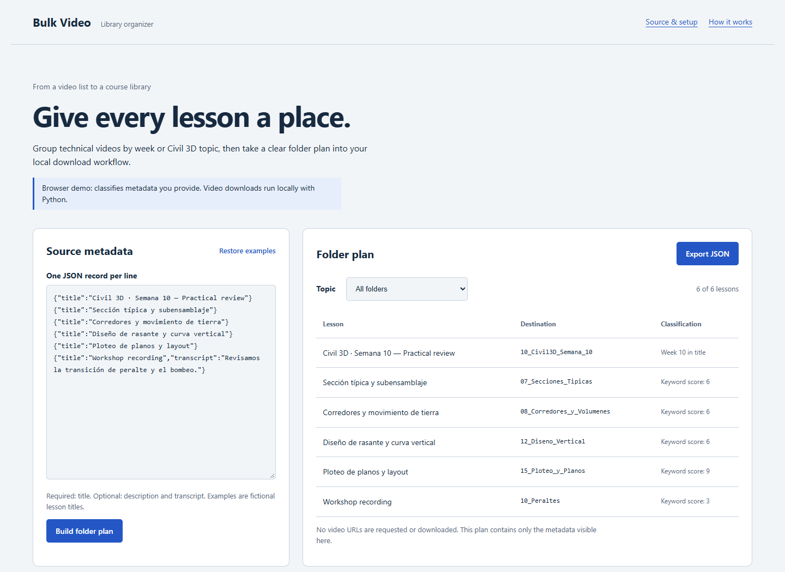

<div align="center">

# Bulk Video

Batch video downloads organized into course weeks and Civil 3D topics, with a browser workspace for exploring the folder plan.

<a href="https://enybyy.github.io/descargar-videos-bulk/"></a>

<p><a href="https://github.com/Enybyy"></a>
<a href="https://www.linkedin.com/in/eliud-rojas-mendoza-414652212/"></a>
<a href="https://www.upwork.com/freelancers/~01471ca462b236e8e5"></a></p>

[](https://enybyy.github.io/descargar-videos-bulk/)

*Actual browser workspace with fictional lesson metadata. Video downloads run in the local Python application.*

[About](#about-the-project) · [Workflow](#everyday-workflow) · [Demo](#explore-the-demo) · [Technology](#built-with) · [Local use](#local-use)

</div>

## About the project

A technical course library often begins as a list of links. As that list grows, lesson order and topic become harder to recover from filenames alone. Bulk Video turns the list into a repeatable local workflow: read the metadata, identify the course week or topic, and download each video into its destination folder.

Explicit week labels take priority; other lessons are grouped using titles, descriptions and optionally available Spanish subtitles. Each completed download has a URL-based record, so reordering the input list does not cause a different lesson to be mistaken for an existing file. A batch report keeps planned, completed, existing and failed jobs visible.

## Everyday workflow

| Inside the project | Detail |
| --- | --- |
| Batch input | One YouTube or Vimeo video URL per line; comments and duplicates are handled. |
| Course organization | Week labels and Civil 3D topics, including corridors, profiles, sections and plotting. |
| Metadata plan | Review classifications without downloading video with `--plan`. |
| Local downloads | Up to three concurrent jobs by default, configurable from one to eight. |
| Completion checks | URL-based state is accepted only when its matching output file still exists. |
| Run report | JSON results with job status, destination and reported errors. |

## Explore the demo

The [browser demo](https://enybyy.github.io/descargar-videos-bulk/) starts with fictional lesson metadata. Edit a title, description or transcript, build a folder plan, filter by destination and export the visible results as JSON. Restore examples to begin again.

The demo applies the same keyword rules as Python, loaded from `demo/rules.json`. It does **not** fetch video metadata, transfer media or simulate downloads. No credentials, accounts or backend are needed. Actual downloads use the local command line.

### Classification in practice

| Input | Destination |
| --- | --- |
| `Civil 3D Semana 10` | `10_Civil3D_Semana_10` |
| `Sección típica y subensamblaje` | `07_Secciones_Tipicas` |
| `Corredores y movimiento de tierra` | `08_Corredores_y_Volumenes` |
| `Diseño de rasante` | `12_Diseno_Vertical` |
| No matching week or keyword | `14_Otros` |

The classifier normalizes accents and underscores, matches complete keyword phrases and supports weeks 1–19. Metadata matches carry three times the weight of transcript matches. Ties follow rule order. This is a deterministic topic sorter, not a semantic model; a manually reviewed plan remains useful for ambiguous titles.

## Built with

| Area | Technology |
| --- | --- |
| Local runner | Python 3.10+ and concurrent futures |
| Video extraction | yt-dlp with its default dependencies |
| Video/audio merging | FFmpeg installed locally |
| Classification | Shared JSON keywords, Unicode normalization and phrase matching |
| Browser demo | HTML, CSS and JavaScript |
| Verification | Python unittest and browser workflow checks |

## Local use

<details>
<summary><strong>Install and run</strong></summary>

Install Python 3.10+ and [FFmpeg](https://ffmpeg.org/download.html), with `ffmpeg` and `ffprobe` on PATH. YouTube support also benefits from a supported JavaScript runtime such as Node.js; see [yt-dlp's runtime instructions](https://github.com/yt-dlp/yt-dlp/wiki/EJS).

```powershell
git clone https://github.com/Enybyy/descargar-videos-bulk.git
cd descargar-videos-bulk
python -m venv .venv
.venv\Scripts\python -m pip install -r requirements.txt
```

Create `links.txt` with one supported video URL per line. Use videos you own or are permitted to download. Lines beginning with `#` are comments. Playlists are excluded.

```powershell
# Fetch metadata and inspect the folder plan first
.venv\Scripts\python descargar.py --plan
# Download and merge video/audio
.venv\Scripts\python descargar.py --workers 3
# Include available Spanish subtitles in topic scoring
.venv\Scripts\python descargar.py --subtitles
# Use an explicit FFmpeg directory and Node executable when needed
.venv\Scripts\python descargar.py --ffmpeg C:\tools\ffmpeg\bin --node C:\tools\node\node.exe
```

`--links` selects a different input file and `--output` selects the output directory. On Linux/macOS use `.venv/bin/python`. Download filenames use a stable URL hash followed by the video title, keeping them independent of input-list position. `downloads/report.json` summarizes the latest batch; `downloads/.state/` stores completion records. Existing files are neither migrated nor deleted automatically.

To run the browser demo locally:

```powershell
python -m http.server 5088 --bind 127.0.0.1
```

Open http://127.0.0.1:5088. Serve over HTTP rather than opening the file directly, so shared rules can load.

</details>

<details>
<summary><strong>Verification and repository contents</strong></summary>

```powershell
python -m unittest discover -s tests -v
```

Tests cover week boundaries, accent normalization, transcript fallback, exact supported hosts, duplicate inputs, matching completion state and output-path containment. Verification details are in [docs/verification.md](docs/verification.md).

| Path | Purpose |
| --- | --- |
| `descargar.py` | Command-line entry point |
| `bulk_video/` | Classification and local download logic |
| `demo/` | Browser controls, styles and shared classification rules |
| `index.html` | Public metadata planner |
| `tests/` | Reproducible core and download-state checks |
| `docs/screenshots/` | Authentic product screenshots |

Personal URL lists, downloads, cookies, environment files, binaries and temporary files are excluded. No authentication cookies or API credentials are included. TLS certificate verification remains enabled. FFmpeg is installed separately; the application does not silently download executable binaries or remote scripts.

</details>

<details>
<summary><strong>Source availability and output limits</strong></summary>

Video providers can change extraction behavior, require authentication or limit access. The runner reports failures rather than claiming every URL can be downloaded. Available formats determine the resulting quality; MP4 is the preferred merge container, while single-stream fallback can retain the source container. Missing Spanish subtitles fall back to metadata classification. Changing URL parameters may create another local task; completion records identify exact input URLs, not all possible aliases of the same video.

Reports and local state include your input URLs and titles, so keep output folders private when those sources are sensitive. No download result is uploaded by the application.

</details>

---

<div align="center">

**Eliud Rojas Mendoza · Enybyy**

<p><a href="https://github.com/Enybyy"></a>
<a href="https://www.linkedin.com/in/eliud-rojas-mendoza-414652212/"></a>
<a href="https://www.upwork.com/freelancers/~01471ca462b236e8e5"></a></p>

</div>
